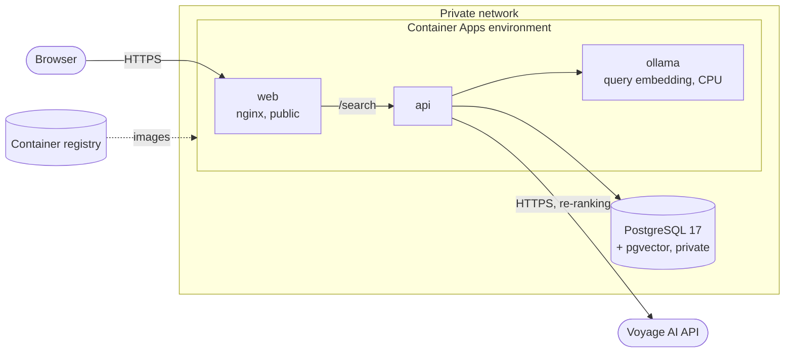

# Running on Azure

Book Finder runs on [Azure Container Apps](https://learn.microsoft.com/azure/container-apps/) with a managed
PostgreSQL server, in **France Central**. Everything is defined in `deploy/azure/main.bicep`. The local Docker
setup (`docker-compose.yml`) keeps working for development and testing.

## Architecture



- **Only `web` is public.** `api` and `ollama` have internal ingress, reachable as `http://<name>` inside the
  environment. The database has no public address: it lives in its own subnet and is found through a private DNS
  zone.
- **Re-ranking is done by [Voyage AI](https://docs.voyageai.com/docs/reranker)** (`rerank-3`), so no model app
  runs for it. Its API key lives in a key vault: you put it there yourself, and the api reads it with its managed
  identity, so the key never goes through a deployment. With `reranker=cpu` or `gpu`, a `reranker` app serves the
  local model instead (see [Local re-ranker](#local-re-ranker)).
- **Images** come from a Basic container registry, pulled with a managed identity (no registry password).
- **The embedding model is built into the image** (see `deploy/ollama`), so containers that scale from zero don't
  download it.

| Resource | Size | Scales |
|---|---|---|
| `web` | 0.25 vCPU, 0.5 GiB | to zero, unless `webApiMinReplicas=1` |
| `api` | 0.25 vCPU, 0.5 GiB | to zero, unless `webApiMinReplicas=1` |
| `ollama` | 1 vCPU, 2 GiB | to zero after `modelCooldownSeconds` (30 min) |
| `reranker` (only with `reranker=cpu` or `gpu`) | 4 vCPU, 8 GiB, or a T4 GPU with 2 vCPU, 8 GiB | to zero after `modelCooldownSeconds` (30 min) |
| PostgreSQL | Flexible Server B1ms (1 vCore, 2 GiB), 32 GB, 7 days of backups | always on (can be stopped, see below) |

## Why France Central

The app is used from Ireland, France and the Netherlands. Of the European regions with serverless T4 GPUs
(Sweden Central, Italy North, France Central, West Europe), France Central is the cheapest for what we use and is
central for those users. North Europe (Ireland) has no serverless GPU. Re-ranking now goes to Voyage AI, but the
region keeps the GPU option open. Prices compared on 2026-10-19 (USD list prices):

| Region | T4 / hour | vCPU / hour | PostgreSQL B1ms / month |
|---|---|---|---|
| **France Central** | $0.33 | $0.09 | $13.87 |
| Sweden Central | $0.34 | $0.09 | $14.53 |
| West Europe | $0.34 | $0.12 | $14.53 |

## Cost

- **Fixed:** about **$20 a month**: PostgreSQL (~$14), its storage, and the registry (~$5). The key vault costs
  cents (billed per 10,000 reads). Apps scaled to zero cost nothing.
- **While in use:** Ollama, api and web cost a few cents an hour, billed per second from when they start until they
  scale to zero, and mostly covered by the monthly free allowance (180,000 vCPU-seconds and 360,000 GiB-seconds per
  subscription).
- **Voyage AI:** billed per token: the query's tokens times the 50 candidates, plus the candidates' cards (about
  8,000 tokens per search). The first 200 million tokens are free, then `rerank-3` costs $0.05 per million tokens.
- **Local re-ranker instead:** about $0.40 an hour on CPU (4 vCPUs and 8 GiB) or $0.55 on a T4, while it is up.

To pause the database between uses (it restarts automatically after 7 days):

```sh
az postgres flexible-server stop  -g bookfinder-rg -n <server>
az postgres flexible-server start -g bookfinder-rg -n <server>
```

## Local re-ranker

With `reranker=cpu` or `gpu`, a `reranker` app runs the local model (`gte-reranker-modernbert-base` served by TEI,
as in `docker-compose.yml`). On CPU it is the same image as locally, with the model's ONNX export. The T4 build
(TEI `turing-1.9`, Candle on CUDA) scores the same cards differently, by up to 0.17 and 0.07 on average over 30
cards, even one card at a time and in float32. Measured on 2026-10-19 with "a man wakes up as an insect":
Metamorphosis 0.93 on CPU vs 0.84 on the T4, an Ant-Man comic 0.66 vs 0.81. Only 6 of the top 10 matched the
local results, while the query vector and the 30 candidates from PostgreSQL were the same. On Azure's 4 vCPUs,
re-ranking 30 cards takes about 6 s, so a warm search takes 7–13 s.

## Cold starts

When an app has scaled to zero, the next request starts it. CPU apps start in seconds (a CPU reranker app is ready
about 7 s after its container starts); a GPU app can take several
minutes the first time (pulling the image onto a GPU host). The cooldown keeps the models warm for 30 minutes after
the last search. A warm-up when the page opens, and a fallback to vector order while the re-ranker starts, are
planned.

## Parameters

| Parameter | Default | |
|---|---|---|
| `location` | resource group's | France Central in our setup |
| `prefix` | `bookfinder` | resource names |
| `postgresPassword` | – | letters and digits only (it goes into a URL) |
| `deployApps` | `true` | `false` on the first run, before the images are in the registry |
| `imageTag` | `latest` | |
| `reranker` | `voyage` | `cpu` or `gpu` run the local model in a `reranker` app instead (see [Local re-ranker](#local-re-ranker)) |
| `webApiMinReplicas` | `0` | `1` keeps web and api running |
| `modelCooldownSeconds` | `1800` | how long ollama and the re-ranker stay up after the last request |

## Deploying

Needs the [Azure CLI](https://learn.microsoft.com/cli/azure/) (`az login`) and, for the database copy, the local
Docker stack with a loaded database. The password is chosen once (letters and digits, at least 16) and must be the
same on every run.

```powershell
$env:BOOKFINDER_DB_PASSWORD = '<password>'
./deploy/azure/deploy.ps1      # infrastructure, images (built in the registry), apps; prints the URL
./deploy/azure/restore-db.ps1  # copies the local database to Azure (about 20 minutes)
```

The Voyage AI key (from the [Voyage dashboard](https://dashboard.voyageai.com/api-keys)) goes into the key vault
once. On the first run, `deploy.ps1` creates the vault, then stops and prints this command with the vault's name;
run it, then `deploy.ps1` again:

```powershell
$key = Read-Host 'Voyage API key' -AsSecureString   # not shown, not in the history
az keyvault secret set --vault-name <vault> -n voyage-api-key -o none --value ([Net.NetworkCredential]::new('', $key).Password)
```

Whoever deploys gets write access to the vault's secrets; the role can take a minute to apply, so retry if `az`
answers Forbidden. To change the key, run the same command, then restart the api so it reads the new one:

```powershell
az containerapp revision restart -g bookfinder-rg -n api --revision (az containerapp show -g bookfinder-rg -n api --query properties.latestRevisionName -o tsv)
```

- `deploy.ps1` tags the images with the current commit. `-SkipImages` redeploys without rebuilding, and
  `-Reranker cpu` or `gpu` switches to the local re-ranker (the script removes the old `reranker` app when
  switching, because the template doesn't remove apps and Azure can't drop a workload profile that an app uses).
- `restore-db.ps1` dumps the local database, uploads it as an image, and restores it with a one-off Container Apps
  job, since the server is only reachable from inside the private network. It replaces what is in the Azure
  database, schema included: Azure runs no migrations. Search reads only keyword vectors (`work_keyword_embeddings`),
  so before deploying a version without description vectors (migration `009`), run `cmd/migrate` and `cmd/index`
  locally, then `restore-db.ps1`; a database without keyword vectors returns no results.

## Check before deploying

```sh
az group create -n bookfinder-rg -l francecentral
az deployment group what-if -g bookfinder-rg -f deploy/azure/main.bicep -p postgresPassword=<password> deployApps=false
```
