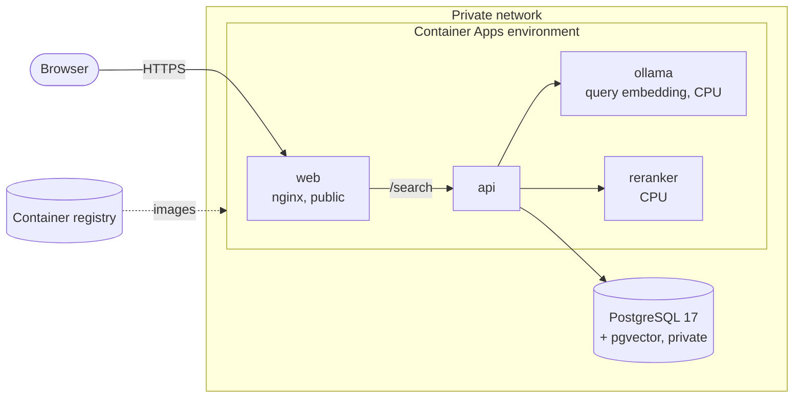

# Running on Azure

Book Finder runs on [Azure Container Apps](https://learn.microsoft.com/azure/container-apps/) with a managed
PostgreSQL server, in **France Central**. Everything is defined in `deploy/azure/main.bicep`. The local Docker
setup (`docker-compose.yml`) keeps working for development and testing.

## Architecture



- **Only `web` is public.** `api`, `ollama` and `reranker` have internal ingress, reachable as `http://<name>`
  inside the environment. The database has no public address: it lives in its own subnet and is found through a
  private DNS zone.
- **Images** come from a Basic container registry, pulled with a managed identity (no registry password).
- **Models are built into the images** (see `deploy/ollama`, `deploy/reranker`), so containers that scale from zero
  don't download them.

| Resource | Size | Scales |
|---|---|---|
| `web` | 0.25 vCPU, 0.5 GiB | to zero, unless `webApiMinReplicas=1` |
| `api` | 0.25 vCPU, 0.5 GiB | to zero, unless `webApiMinReplicas=1` |
| `ollama` | 1 vCPU, 2 GiB | to zero after `modelCooldownSeconds` (30 min) |
| `reranker` | 4 vCPU, 8 GiB (or a T4 GPU with 2 vCPU, 8 GiB: `rerankerGpu=true`) | to zero after `modelCooldownSeconds` (30 min) |
| PostgreSQL | Flexible Server B1ms (1 vCore, 2 GiB), 32 GB, 7 days of backups | always on (can be stopped, see below) |

## Why France Central

The app is used from Ireland, France and the Netherlands. Of the European regions with serverless T4 GPUs
(Sweden Central, Italy North, France Central, West Europe), France Central is the cheapest for what we use and is
central for those users. North Europe (Ireland) has no serverless GPU. The re-ranker now runs on CPU (see
[Re-ranker on CPU](#re-ranker-on-cpu)), but the region keeps the GPU option open. Prices compared on 2026-10-19 (USD
list prices):

| Region | T4 / hour | vCPU / hour | PostgreSQL B1ms / month |
|---|---|---|---|
| **France Central** | $0.33 | $0.09 | $13.87 |
| Sweden Central | $0.34 | $0.09 | $14.53 |
| West Europe | $0.34 | $0.12 | $14.53 |

## Cost

- **Fixed:** about **$20 a month**: PostgreSQL (~$14), its storage, and the registry (~$5). Apps scaled to zero
  cost nothing.
- **While in use:** the re-ranker replica costs about $0.40 an hour (4 vCPUs and 8 GiB), billed per second from
  when it starts until `modelCooldownSeconds` after the last search. Ollama, api and web add a few cents an hour.
  The monthly free allowance (180,000 vCPU-seconds and 360,000 GiB-seconds per subscription) covers about the first
  10 hours of use. On a T4 the re-ranker costs about $0.55 an hour, always billed at the active rate.

To pause the database between uses (it restarts automatically after 7 days):

```sh
az postgres flexible-server stop  -g bookfinder-rg -n <server>
az postgres flexible-server start -g bookfinder-rg -n <server>
```

## Re-ranker on CPU

The re-ranker runs the same image on Azure as locally: TEI on CPU with the model's ONNX export. The T4 build
(TEI `turing-1.9`, Candle on CUDA) scores the same cards differently, by up to 0.17 and 0.07 on average over 30
cards, even one card at a time and in float32. Measured on 2026-10-19 with "a man wakes up as an insect":
Metamorphosis 0.93 on CPU vs 0.84 on the T4, an Ant-Man comic 0.66 vs 0.81. Only 6 of the top 10 matched the
local results, while the query vector and the 30 candidates from PostgreSQL were the same. The ranking was tuned
on CPU, so Azure uses CPU too. Re-ranking 30 cards takes about 6 s on Azure's 4 vCPUs (4 s on a local machine
limited to 4 CPUs), so a warm search takes 7–13 s.

## Cold starts

When an app has scaled to zero, the next request starts it. CPU apps start in seconds (the re-ranker is ready
about 7 s after its container starts); a GPU app can take several
minutes the first time (pulling the image onto a GPU host). The cooldown keeps the models warm for 30 minutes after
the last search. A warm-up when the page opens, and a fallback to vector order while the re-ranker starts, are
planned.

## Parameters

| Parameter | Default | |
|---|---|---|
| `location` | resource group's | France Central in our setup |
| `prefix` | `bookfinder` | resource names |
| `postgresPassword` | – | letters and digits only (it goes into a URL) |
| `deployApps` | `true` | `false` on the first run, before the images are in the registry |
| `imageTag` | `latest` | |
| `rerankerGpu` | `false` | `true` runs the re-ranker on a T4 GPU (see below) |
| `webApiMinReplicas` | `0` | `1` keeps web and api running |
| `modelCooldownSeconds` | `1800` | how long ollama and the re-ranker stay up after the last request |

## Check before deploying

```sh
az group create -n bookfinder-rg -l francecentral
az deployment group what-if -g bookfinder-rg -f deploy/azure/main.bicep -p postgresPassword=<password> deployApps=false
```

Building the images, deploying and copying the database are covered by the deployment script (next step).
